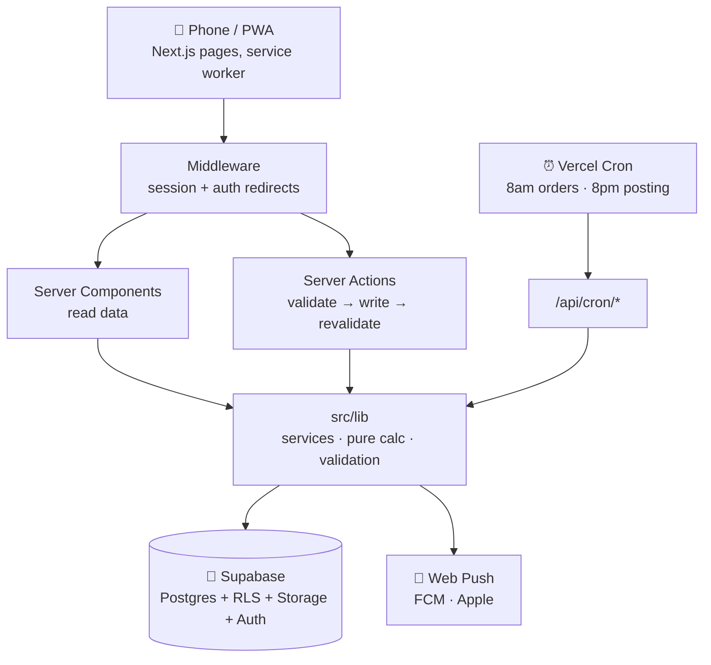

<div align="center">


# AdikAkak Bites · Business Control Centre

**The back office of a small Malaysian dessert business, in your pocket.**
Orders, ready stock, recipes, sales and the day's plan, built for one-handed use at the counter.


</div>

---

## Why it exists

Running a home dessert business means juggling WhatsApp orders, baking slots, Instagram posts and "do we still have butter?" all at once. This app answers one question first: **what should I be doing right now?** Then it keeps everything else (orders, stock, money) out of your head.

It runs entirely on free plans, uses **no AI and no paid services**, and installs on a phone like a normal app.

## ✨ What it does

| | Feature | In short |
|---|---|---|
| 🌅 | **Today** | Greeting, the current schedule block in its own colour, tick-off tasks, three daily priorities, orders coming up in the next 7 days, ready stock at a glance |
| 🧾 | **Orders** | Grouped by when they're due (overdue, today, tomorrow, later), deposits and balances, past sales, sale-date correction |
| 💬 | **Paste from WhatsApp** | Paste a customer's filled-in order template and the order fills itself: Malay and English dates, "2x", "ITEM-1", typos, sizes like 6″/8″ |
| 📖 | **Customer menu** | A public page with your PDF catalogue and an order form that sends your template to your WhatsApp |
| 🧁 | **Products** | Photos, categories, search, price, cost, profit and margin; ready stock with quick − / + buttons |
| 🥣 | **Recipes** | Ingredients per batch, cost per piece, "can make 18 with stock now", and automatic ingredient deduction |
| 📦 | **Inventory** | Reorder levels, usage, waste and purchases, low-stock alerts |
| 👥 | **Customers** | Phone-first identity (no duplicate Aisyahs), spending and repeat-customer metrics |
| 📊 | **Sales** | Today, this week, this month, a monthly report with per-day bars and best sellers, the daily close |
| 🧾 | **Receipts** | Sequential receipt numbers, print, or send as a PDF on WhatsApp |
| 📸 | **Content** | Daily posting checklist for Instagram, Facebook and WhatsApp, with a 🔥 streak |
| 🔔 | **Notifications** | Web push for low stock, orders due in 2 days, schedule changes and the 8pm posting reminder |
| 👩‍🍳 | **Team** | Owner, admin and staff roles; the owner creates staff logins directly (no invite emails) |
| 🩺 | **System status** | Supabase usage against free-plan limits, missing migrations, key checks, daily-job health |

## 🧱 How it's built



- **Next.js 14 (App Router)** with Server Components and Server Actions, so there's no separate backend to run.
- **Supabase** handles Postgres, Auth and Storage. **Row Level Security protects every table**, and atomic actions (stock, receipt numbers, recipes) run as SQL functions.
- **The maths has no database or network code** (`src/lib/calc`, the paste reader, notifications wording), so it's fully unit-tested.
- **Derived numbers are computed, never stored.** Totals, margins, stock status and sales can't drift out of sync.
- **Deployed on Vercel** in Tokyo (`hnd1`), next to the database in `ap-northeast-1`.

<details>
<summary><b>Tech stack and dependencies</b></summary>

| Runtime | Why |
|---|---|
| `next` 14 · `react` 18 | App, Server Components, Server Actions |
| `@supabase/supabase-js` · `@supabase/ssr` (pinned) | Database, auth, storage, cookie sessions |
| `web-push` | Phone notifications (VAPID) |
| `html-to-image` · `jspdf` | Receipt PDFs, loaded only when needed |

Dev: TypeScript (strict), Tailwind CSS, Vitest, ESLint.
</details>

## 🚀 Quick start

```bash
git clone https://github.com/Harith98/AdikAkakBite.git
cd AdikAkakBite
npm install
cp .env.example .env.local   # then fill it in (see below)
npm run dev                  # http://localhost:3000
```

1. **Create a free [Supabase](https://supabase.com) project.**
2. **Run every file in [`supabase/migrations/`](supabase/migrations) in order** (`0001` → `0023`) in the Supabase SQL Editor, or `supabase db push` if you use the CLI.
3. **Fill in `.env.local`,** then open the app, sign up, and complete first-time setup. This creates the business and a starter daily schedule.
4. *(Optional)* **[`supabase/seed_demo_data.sql`](supabase/seed_demo_data.sql)** adds sample products, stock and customers tagged `[DEMO]`.

> 💡 After the app is running, **Settings → System status** tells you exactly which migrations or keys are still missing.

### Environment variables

| Variable | Needed for | Secret? |
|---|---|---|
| `NEXT_PUBLIC_SUPABASE_URL` · `NEXT_PUBLIC_SUPABASE_ANON_KEY` | Everything | No |
| `SUPABASE_SERVICE_ROLE_KEY` | Adding staff, password resets, notifications | 🔒 **Yes** |
| `NEXT_PUBLIC_VAPID_PUBLIC_KEY` · `VAPID_PRIVATE_KEY` | Phone notifications (`npx web-push generate-vapid-keys`) | 🔒 private key |
| `CRON_SECRET` | Daily 8am / 8pm reminders | 🔒 **Yes** |
| `NEXT_PUBLIC_SITE_URL` | Links in emails (defaults to the production domain) | No |
| `NEXT_PUBLIC_DEFAULT_CURRENCY` · `NEXT_PUBLIC_DEFAULT_TIMEZONE` | Optional overrides (MYR, Asia/Kuala_Lumpur) | No |

Never prefix a secret with `NEXT_PUBLIC_`, and never change the VAPID keys once people have subscribed.

## 🛠️ Scripts

| Command | Does |
|---|---|
| `npm run dev` | Local dev server |
| `npm run build` · `npm start` | Production build / serve it |
| `npm run typecheck` | `tsc --noEmit` |
| `npm run lint` | ESLint |
| `npm test` | Vitest unit tests (200+, run in about 2 s) |
| `npm run db:types` | Regenerate `database.types.ts` from the live schema |

Run **typecheck, lint and test** before every commit.

## 🗂️ Where things live

```
src/
├─ app/
│  ├─ (app)/          signed-in app: today, orders, business/*, content, settings/*
│  ├─ menu/           public customer menu (no login)
│  ├─ receipt/        printable receipts
│  └─ api/            auth callback, cron jobs
├─ components/        ui/ · layout/ · today/ · orders/ · business/ · settings/ · menu/
└─ lib/
   ├─ calc/           pure maths (orders, products, recipes, sales, inventory)
   ├─ services/       data access + the Today recommendation engine
   ├─ notifications/  push wording, sending, daily reminders
   └─ whatsapp-order.ts   the template reader & writer
supabase/migrations/  0001 → 0023, applied in order
tests/unit/           Vitest suites
```

## 📱 Install it like an app

- **iPhone:** Safari → Share → **Add to Home Screen**. Notifications need iOS 16.4+ and the Home Screen app.
- **Android:** Chrome → menu → **Install app**.

The service worker only registers in production builds (`npm run build && npm start`).

## 🚢 Deploying

1. Import the repo into **Vercel** and add the environment variables above.
2. **Run any new migration in Supabase before deploying code that needs it.**
3. Vercel picks up the daily cron jobs from [`vercel.json`](vercel.json) automatically.

More in [`docs/deployment.md`](docs/deployment.md), and the full schema history is in [`docs/database.md`](docs/database.md).

## 🔐 Security in one breath

**Every business table has Row Level Security.** The service-role key is server-only and used only behind an owner/admin check. The public menu reads a single safe function that returns only the shop name, phone and catalogue link. The audit log is append-only, and the repo contains no secrets.

## 🗺️ What's next

- [ ] Dashboard and goals: trends, comparisons and progress bars
- [ ] Forecasts: busy days, and when stock will run out
- [ ] Product nicknames, so pasted orders match customers' own words
- [ ] CSV export, which doubles as a backup

<div align="center">

---

Made with 🧁 for **AdikAkak Bites** · Freshly made · Limited slots

</div>
