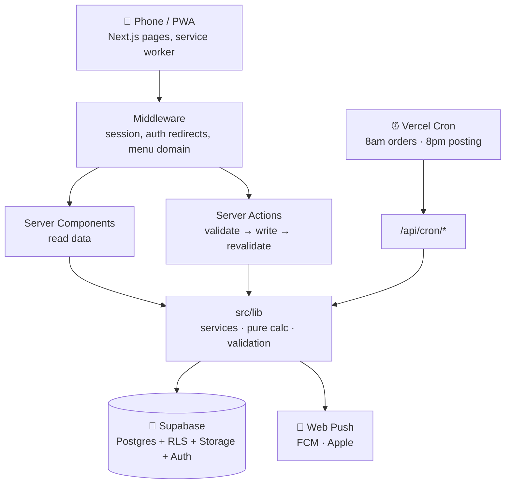

<div align="center">


# AdikAkak Bites · Business Control Centre

**The back office of a small Malaysian dessert business, in your pocket.**
Orders, ready stock, recipes, money and the day's plan, built for one-handed use at the counter.


</div>

---

## Why it exists

Running a home dessert business means juggling WhatsApp orders, baking slots, Instagram posts and "do we still have butter?" all at once. This app answers one question first: **what's happening right now, and what needs me?** Then it keeps everything else (orders, stock, money) out of your head.

It runs entirely on free plans, uses **no AI and no paid services**, and installs on a phone like a normal app.

## ✨ What it does

**Running the day**

| | Feature | In short |
|---|---|---|
| 🌅 | **Today** | Greeting and headline, a timetable card (the current block with a time bar, ideas for it, next and later), orders due, three daily priorities, orders coming up in the next 7 days, ready stock at a glance |
| 🧾 | **Orders** | Grouped by when they're due, filtered by month, deposits and balances, past sales and sale-date correction |
| 💬 | **Paste from WhatsApp** | Paste a customer's filled-in order template and the order fills itself: Malay and English dates, "2x", typos, sizes like 6″/8″, and each product's nicknames |
| 🧾 | **Receipts** | Sequential receipt numbers, print, or send as a PDF on WhatsApp |
| 🔔 | **Notifications** | Web push for low stock, orders due in 2 days, schedule changes and the 8pm posting reminder; each device has a name, and signing out turns that device off |

**The business**

| | Feature | In short |
|---|---|---|
| 🧁 | **Products** | Photos framed with a square cropper (plus a small copy for fast grids), categories, search, nicknames, price, cost and margin; ready stock with − / + buttons |
| 🥣 | **Recipes** | Ingredients per batch, cost per piece, "can make 18 with stock now", automatic ingredient deduction |
| 📦 | **Inventory** | Reorder levels, a shopping list you can send on WhatsApp, usage, waste and purchase history |
| 👥 | **Customers** | Phone-first identity (no duplicate Aisyahs), spending, regulars and quiet customers |
| 📊 | **Sales** | Today and this week, plus a monthly report: per-day bars, best sellers with profit, **gross profit** (each sale at the cost it had that day), **overheads** and **net profit** |
| 🧾 | **Expenses** | Overheads only (rent, utilities, petrol, equipment, marketing, other), with monthly repeating costs; ingredients stay in product costs so nothing is counted twice |
| 📤 | **Money reports & backups** | Monthly summary, sales detail and expenses as CSV for any date range, with TOTAL rows that match each other so you can check every figure; plus full lists for backup |

**Reaching customers**

| | Feature | In short |
|---|---|---|
| 📖 | **Customer menu** | A public page on its own address: the PDF catalogue, an order form that sends your template to WhatsApp, and Follow Us buttons (Instagram, Facebook, TikTok, Threads) |
| 📸 | **Content** | "What to post today" (from ready stock and best sellers), a daily checklist for Instagram, Threads, Facebook and WhatsApp with a 🔥 streak, saved captions you copy in one tap, and a monthly summary |

**Looking after it**

| | Feature | In short |
|---|---|---|
| 👩‍🍳 | **Team** | Owner, admin and staff roles; the owner creates staff logins directly (no invite emails) |
| 🩺 | **System status** | For the owner and admins: free-plan usage (database, photos, an estimate of catalogue PDF downloads), database version, key checks, daily-job health, and who has notifications on, device by device |

The app works the same on a phone, a tablet or a computer: wider screens get two-column layouts, and every "Are you sure?" and "Saved ✓" uses the app's own pop-ups.

## 🧱 How it's built



- **Next.js 14 (App Router)** with Server Components and Server Actions, so there's no separate backend to run.
- **Supabase** handles Postgres, Auth and Storage. **Row Level Security protects every table**, and atomic actions (stock, receipt numbers, recipes) run as SQL functions.
- **The maths has no database or network code** (`src/lib/calc`, the paste reader, expenses, content and notification wording), so it's fully unit-tested.
- **Derived numbers are computed, never stored.** Totals, margins, profit, stock status and streaks can't drift out of sync.
- **Deployed on Vercel** in Tokyo (`hnd1`), next to the database in `ap-northeast-1`.

<details>
<summary><b>Tech stack and dependencies</b></summary>

| Runtime | Why |
|---|---|
| `next` 14.2 · `react` 18 | App, Server Components, Server Actions |
| `@supabase/supabase-js` · `@supabase/ssr` (pinned) | Database, auth, storage, cookie sessions |
| `web-push` | Phone notifications (VAPID) |
| `html-to-image` · `jspdf` 4 | Receipt PDFs, loaded only when needed |

Dev: TypeScript (strict), Tailwind CSS, Vitest, ESLint.
</details>

## 🚀 Quick start

```bash
git clone https://github.com/Harith98/AdikAkakBite.git
cd AdikAkakBite
npm install
cp .env.example .env.local   # then fill it in (see below)
npm run dev                  # http://localhost:3000
```

1. **Create a free [Supabase](https://supabase.com) project.**
2. **Run [`supabase/schema.sql`](supabase/schema.sql) once** in the Supabase SQL Editor. One file sets up the whole database, at its latest version.
3. **Fill in `.env.local`,** then open the app, sign up, and complete first-time setup. This creates the business and a starter daily schedule.
4. *(Optional)* **[`supabase/seed_demo_data.sql`](supabase/seed_demo_data.sql)** adds sample products, stock and customers tagged `[DEMO]`.

> 💡 After the app is running, **Settings → System status** tells you if the database needs an update or a key is missing.

### Environment variables

| Variable | Needed for | Secret? |
|---|---|---|
| `NEXT_PUBLIC_SUPABASE_URL` · `NEXT_PUBLIC_SUPABASE_ANON_KEY` | Everything | No |
| `SUPABASE_SERVICE_ROLE_KEY` | Adding staff, password resets, notifications, the catalogue counter | 🔒 **Yes** |
| `NEXT_PUBLIC_VAPID_PUBLIC_KEY` · `VAPID_PRIVATE_KEY` | Phone notifications (`npx web-push generate-vapid-keys`) | 🔒 private key |
| `VAPID_SUBJECT` | Optional contact for push services (defaults to the site address) | No |
| `CRON_SECRET` | Daily 8am / 8pm reminders | 🔒 **Yes** |
| `NEXT_PUBLIC_MENU_URL` | The customer menu's own address (recommended): on it only the menu exists | No |
| `NEXT_PUBLIC_SITE_URL` | Links in emails (defaults to the production domain) | No |
| `NEXT_PUBLIC_DEFAULT_CURRENCY` · `NEXT_PUBLIC_DEFAULT_TIMEZONE` | Optional overrides (MYR, Asia/Kuala_Lumpur) | No |
| `SUPABASE_PROJECT_ID` | `npm run db:types` only | No |

Never prefix a secret with `NEXT_PUBLIC_`, and never change the VAPID keys once people have subscribed.

## 🛠️ Scripts

| Command | Does |
|---|---|
| `npm run dev` | Local dev server |
| `npm run build` · `npm start` | Production build / serve it |
| `npm run typecheck` | `tsc --noEmit` |
| `npm run lint` | ESLint |
| `npm test` | Vitest unit tests (240+, run in about 2 s) |
| `npm run db:types` | Regenerate `database.types.ts` from the live schema |

Run **typecheck, lint and test** before every commit.

## 🗂️ Where things live

```
src/
├─ app/
│  ├─ (app)/          signed-in app: today, orders, business/*, content, settings/*
│  ├─ menu/           public customer menu (no login) + /menu/catalogue counter
│  ├─ receipt/        printable receipts
│  └─ api/            auth callback, cron jobs, CSV exports
├─ components/        ui/ · layout/ · today/ · orders/ · business/ · content/ · settings/ · menu/
└─ lib/
   ├─ calc/           pure maths (orders, products, recipes, sales and profit, inventory)
   ├─ services/       data access for each part of the app
   ├─ notifications/  push wording, sending, daily reminders
   ├─ expenses.ts · content.ts   overheads, posting rules and suggestions
   └─ whatsapp-order.ts          the template reader & writer
supabase/schema.sql   the whole database, in one file
supabase/updates/     changes to an existing database, one dated file each
tests/unit/           Vitest suites
```

## 📱 Install it like an app

- **iPhone:** Safari → Share → **Add to Home Screen**. Notifications need iOS 16.4+ and the Home Screen app.
- **Android:** Chrome → menu → **Install app**.

The service worker only registers in production builds (`npm run build && npm start`).

## 🚢 Deploying

1. Import the repo into **Vercel** and add the environment variables above.
2. **Database changes come as files in [`supabase/updates/`](supabase/updates).** Run each new one in the Supabase SQL Editor, oldest first, **before** deploying the code that needs it. Settings → System shows the database version the code expects.
3. Vercel picks up the daily cron jobs from [`vercel.json`](vercel.json) automatically.

More in [`docs/deployment.md`](docs/deployment.md), and how the database is set up and changed is in [`docs/database.md`](docs/database.md).

### Staying on the free plans

Everything fits the free tiers for years at a small shop's size. The one thing to watch is **the catalogue PDF**: every customer who opens it uses some of Supabase's 5 GB of monthly data transfer, so keep it under 10 MB. Add a Canva or Google Drive link in Settings → Customer menu as a safety net: on "Automatic", the catalogue switches to that link at 80% of the month's free data, and the owner and admins get a notification. System status shows a running estimate. The free plan has no automatic backups, so download the exports once a month.

## 🔐 Security in one breath

**Every business table has Row Level Security.** The service-role key is server-only and used only behind a role check or a fixed server task. The public menu reads one safe function that returns only the shop name, phone, catalogue link and social links, and runs on its own address where no app page or API exists. Signing out turns off that device's notifications. The audit log is append-only, and the repo contains no secrets.

## 🗺️ What's next

- [ ] Money to collect: every order with a balance still owed, with a reminder button
- [ ] Dashboard and goals: a monthly sales target with progress
- [ ] Forecasts: busy days, and when stock will run out
- [ ] Optional AI assistant on top of the existing reports (see [`docs/ai-readiness.md`](docs/ai-readiness.md))

<div align="center">

---

Made with 🧁 for **AdikAkak Bites** · Freshly made · Limited slots

</div>
